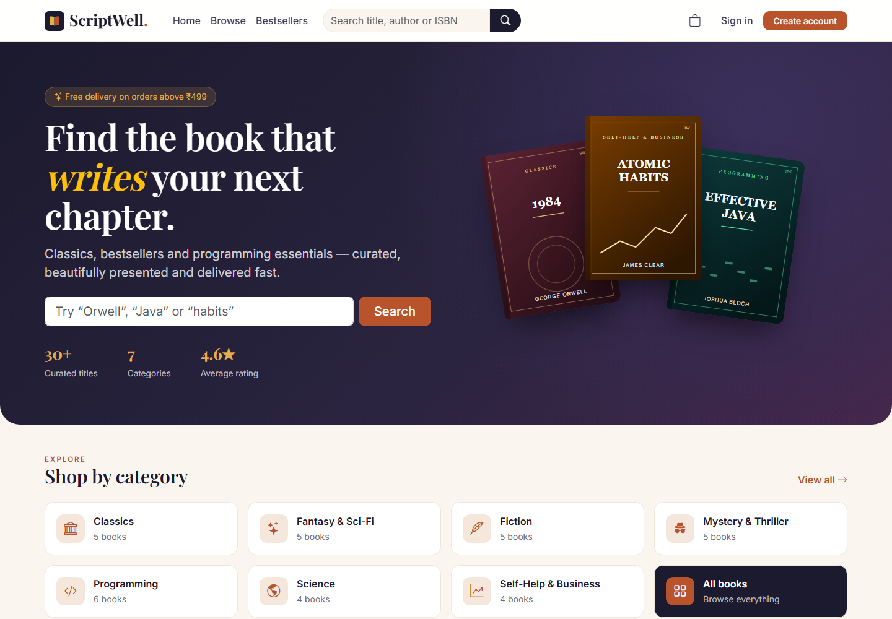

# ScriptWell — Online Book Store

A full-stack online bookstore built as a university mini project for **Advanced Internet Programming** and **PL/SQL**.

- **Front end:** JSP + JSTL, HTML5, CSS3, JavaScript, Bootstrap 5
- **Back end:** Java Servlets (Jakarta EE 10) following **MVC**, JDBC with `CallableStatement`
- **Database:** Oracle Database Free 23ai. The business logic lives in **PL/SQL packages, procedures, functions, triggers and cursors**
- **Tools:** Eclipse IDE (Dynamic Web Project), Apache Tomcat 11.0 (also compatible with 10.1), JDK 17+



## Features

| Customer | Administrator |
|---|---|
| Browse 34 books in 7 categories | Dashboard with revenue, orders and a category sales chart |
| Keyword search, category, price filters and sorting | Add, edit and delete books (CRUD) |
| Book details with related titles | Books that have been sold are deactivated, not deleted |
| Register and log in (SHA-256 hashing in PL/SQL) | Inventory: low-stock list, restock, stock movement log |
| Cart with quantity management (AJAX add-to-cart) | Order management: filter by status and update status |
| **Buy Now** single-item checkout | Customer list with order count and total spent |
| Checkout with simulated Card / UPI / COD payment | |
| Order confirmation, order history, cancel before shipping | |

## Project structure

```
scriptwell/
├── database/                 Oracle scripts (run 00_install.sql)
│   ├── 01_schema.sql         tables, constraints, indexes, view
│   ├── 02_functions.sql      stand-alone functions + procedure
│   ├── 03_packages.sql       pkg_user, pkg_book, pkg_cart, pkg_order
│   ├── 04_triggers.sql       4 triggers (validation + audit)
│   └── 05_seed.sql           categories, 34 books, demo users and orders
├── src/main/java/
│   ├── db.properties         JDBC connection settings
│   └── com/scriptwell/
│       ├── controller/       Servlets (the C in MVC)
│       ├── dao/              JDBC CallableStatement data access
│       ├── model/            JavaBeans (the M in MVC)
│       ├── filter/           AuthFilter, EncodingFilter
│       └── util/             DBConnection, WebUtil
├── src/main/webapp/
│   ├── WEB-INF/views/        JSP views (the V in MVC) + admin/
│   ├── WEB-INF/tags/         bookCard.tag (reusable JSP tag file)
│   ├── WEB-INF/lib/          ojdbc11, JSTL 3.0
│   └── assets/               css, js, images, SVG book covers
├── scripts/generate_seed.py  regenerates seed SQL + book covers
├── report/                   project report (PDF) and screenshots
└── build.bat / deploy.ps1    command-line build without Eclipse
```

## How to run

### 1. Database (Oracle Database Free)

Either install Oracle Database Free, or run it in Docker:

```bash
docker run -d --name scriptwell-oracle -p 1521:1521 -e ORACLE_PASSWORD=oracle -e APP_USER=scriptwell -e APP_USER_PASSWORD=scriptwell gvenzl/oracle-free:23-slim-faststart
```

If you installed Oracle yourself, create the user first (as SYSTEM, in `FREEPDB1`):

```sql
CREATE USER scriptwell IDENTIFIED BY scriptwell QUOTA UNLIMITED ON users;
GRANT CREATE SESSION, CREATE TABLE, CREATE VIEW, CREATE SEQUENCE,
      CREATE PROCEDURE, CREATE TRIGGER TO scriptwell;
```

Then run the install script as `scriptwell` (SQL Developer: open `database/00_install.sql` and press **F5**, or):

```bash
sqlplus scriptwell/scriptwell@//localhost:1521/FREEPDB1 @database/00_install.sql
```

The connection settings are in `src/main/java/db.properties`.

### 2. Application (Eclipse + Tomcat 11.0)

1. **File → Import → General → Existing Projects into Workspace**, then select the `scriptwell` folder.
2. Add an **Apache Tomcat v11.0** server runtime (Window → Preferences → Server → Runtime Environments) pointing to your Tomcat 11 installation; use JDK 17 or newer.
3. Right-click the project, then **Run As → Run on Server**.
4. Open <http://localhost:8080/scriptwell/>.

The project is configured for the Tomcat 11.0 runtime in Eclipse. Tomcat 10.1 is also supported: configure its Eclipse runtime and select that runtime for the project before publishing.

Without Eclipse:

```bash
build.bat "C:\path\to\apache-tomcat-11.0.x"
```

Copy `dist\scriptwell.war` to Tomcat's `webapps` folder and start Tomcat.
Alternatively, rebuild and deploy in one step with `.\deploy.ps1 -Tomcat "C:\path\to\apache-tomcat-11.0.x"`.

### Demo accounts

| Role | Email | Password |
|---|---|---|
| Customer | demo@scriptwell.com | demo123 |
| Admin | admin@scriptwell.com | admin123 |

For the simulated card payment, use the test card `4111 1111 1111 1111` with any future expiry date (MM/YY) and any 3-digit CVV.

## PL/SQL objects

| Type | Name | Purpose |
|---|---|---|
| Package | `pkg_user` | register, login (SHA-256 via `STANDARD_HASH`), list users |
| Package | `pkg_book` | search with filters (REF CURSOR), CRUD, stock adjust, low stock, inventory log |
| Package | `pkg_cart` | add / update / remove / clear, `cart_total`, `cart_count` |
| Package | `pkg_order` | `place_order` (explicit cursor + `FOR UPDATE`), `buy_now`, history, status, cancel with restock |
| Function | `fn_shipping_charge` | free delivery at ₹499 and above, otherwise ₹49 |
| Function | `fn_is_in_stock` | stock check with a `NO_DATA_FOUND` handler |
| Function | `fn_total_revenue` | revenue from non-cancelled orders |
| Procedure | `sp_get_dashboard_stats` | six OUT parameters for the admin dashboard |
| Trigger | `trg_users_normalize` | lower-case and validate email |
| Trigger | `trg_books_before_save` | trim data, reject future publication years |
| Trigger | `trg_books_stock_audit` | writes every stock change to `inventory_log` |
| Trigger | `trg_orders_status_audit` | records status history in `order_status_audit` |

Errors raised with `RAISE_APPLICATION_ERROR` (-20001 … -20010) are shown to the user as friendly messages by `DBConnection.friendlyMessage()`.
